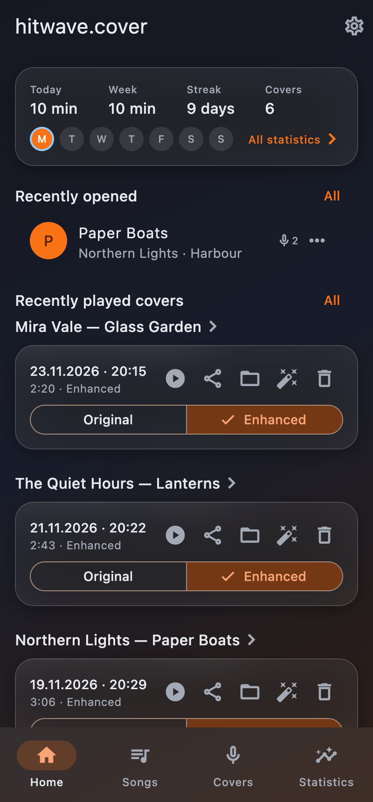
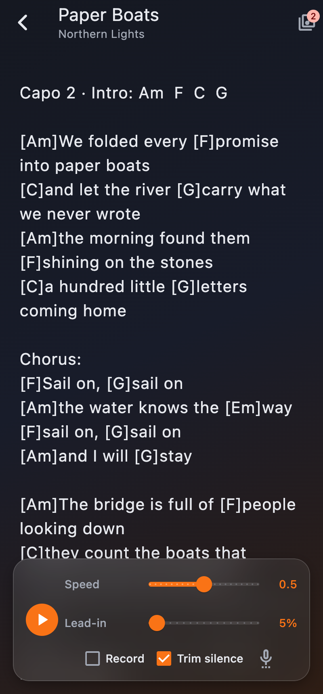
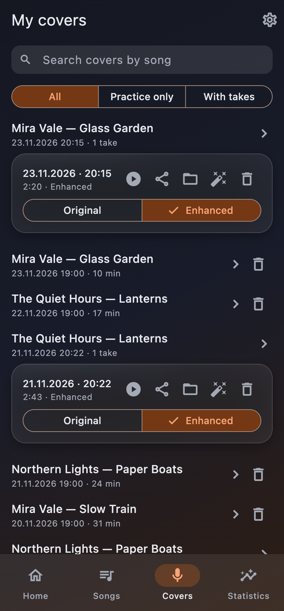
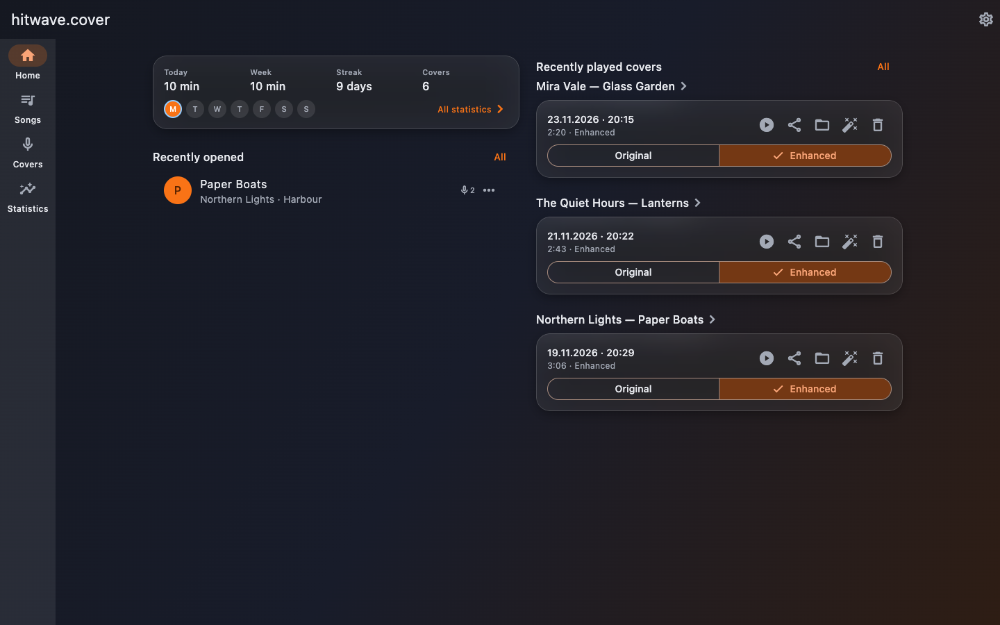
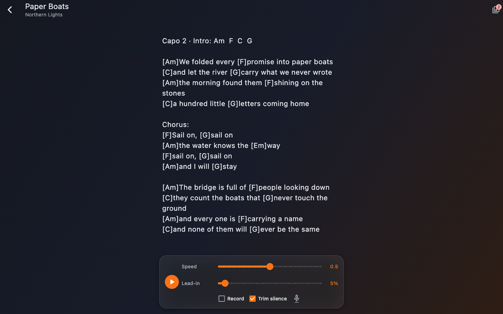

# Hitwave Cover

[English](README.md) · **Меджусловјанскы**

Hitwave Cover држи тексты ваших пєснеј и ваше каверы на једном мєсту. Отворите пєсњу, пустите текст течи в вашем темпу, појте и запишите запис — апликација очисти звук на устројству, држи всакы запис при јего пєсњи и рахује, колико вы тренујете.

Написано на Flutter за Android, iOS, macOS, Windows, Linux и веб.

## Снимкы екрана

| Домов | Текст | Мојі каверы | Статистика |
|---|---|---|---|
|  |  |  |  |





### Темы

Четыри стиља — свєтло и тємно стекло, свєтли и тємни неуморфизм — и осем акцентних барв; избирајут се в Наставјењах:


## Можности

### Пєсни и тексты
- Библиотека пєснеј с изполнитељем, назвоју, албумом и текстом: додавајте, урејајте и бришите је.
- Искање по пєсњи или изполнитељу; разврстање по изполнитељах, А–Ж, недавно отвореных или по числу каверов.
- Страница текста сама прокручује текст. Скорост и отступ пред првоју линијеју сут запомњене за всаку пєсњу.

### Запис каверов
- Означите **Запис** и притисните **Старт**: запис иде, доколє текст се прокручује.
- Изберите микрофон; апликација упозори на запис без звука.
- **Улєпшење гласа** иде на устројству в вбудованом Python: одстрањаје гул и постојанны шум, выравњаје гласност и, ако хочете, обрєзаје тишину пред и по пєњу. Оригинал и улєпшены запис оба остајут.
- Слушајте записы, пошљите запис како MP3 (с готовым описом) или покажите его в папке.
- **Моје каверы**: все записы всих пєснеј в једном спису, с искањем.

### Тренинг
- Врєме с каждоју пєсњеју се рахује само.
- Статистика: днес, тутој тыдењ и тутој мєсец, серија дниј, число записов, календар мєсеца с дњами тренинга и најчестєјше пєсни.
- Домашња картка показује недавно отворене пєсни и недавно слушане каверы.

### Синхронизација и резервне копије
- Все остаје на устројству; конто не јест потрєбно.
- **Синхронизација меджу устројствами** в локалној сети Wi‑Fi: једно устројство показује QR-код, друго его сканује. Пєсни, каверы, тренингы и историја се сједињајут; ничто не јест избрисано без пытања — апликација показује различија и даје избрати, что дєлати на обох устројствах.
- **Резервна копија**: експортујте пєсни в фајл и импортујте је назад; с записами фајл јест ZIP-архив.
- **Наставјења → Дане** такоже очишчајут пєсни, каверы, статистику тренингов или историју.

### Наставјења
- **Језык**: англијскы (по умолчању) или меджусловјанскы (писаны кирилицоју).
- **Тема**: свєтло или темно стекло, свєтлы или темны неуморфизм.
- **Акцентна барва**: једна из осмих.

## Како почати

Трєбује се: Flutter (Dart `^3.12`); Xcode за iOS и macOS, Android Studio за Android.

```bash
flutter pub get
flutter run                          # Android, iOS, macOS: the build packages Python itself
tool/flutter_python.sh windows run   # Windows and Linux: package Python, then run
```

Улєпшење гласа потрєбује вбудованы Python из `python/` (глејте [python/README.md](python/README.md)). Вебова верзија не имаје вбудованого Python и синхронизације меджу устројствами: там апликација држи пєсни и тексты без улєпшења гласа.

## Развој

- **Архитектура**: чиста архитектура по шаблону `revoockv-original@2.0.0` скила [revoockv-flutter-clean-arch](https://github.com/revoockv/revoockv-flutter-clean-arch) (глејте `.clean_arch.toml`); јего линтер провєрјаје код в CI: всака функција в `lib/features/<feature>/` имаје слоје `data`, `domain` и `presentation`; стан живје в репозиторијах како `ValueNotifier` и доходи до интерфејса чрез усе цасе и `watch_it`; зависности сут регистроване с GetIt.
- **Погрєшкы**: операције врачајут `Result<T, F>`, кде `F` јест енум погрєшек функције; јего текст се избираје в `presentation/l10n/`.
- **Преводы**: [slang](https://pub.dev/packages/slang). Тексты сут в `lib/core/presentation/l10n/en.i18n.json` и `isv.i18n.json`; по измєнах пустите `dart run slang`.
- **Темы**: `lib/core/presentation/theme.dart` гради тему из стиља, јаркости и акцента; `SurfaceWidget` рисује стекљане или неуморфне панели.
- **Храњење**: Hive на устројству.

```bash
flutter analyze
flutter test --concurrency=1
```

Git: `develop` сбира работу; всака измєна имаје своју вєтв — `feature/NNN-name`, `fix/NNN-name`, `refactor/NNN-name`, `docs/NNN-name` — с комитами `[TYPE-NNN] …`, слита в `develop` с `--no-ff`.
