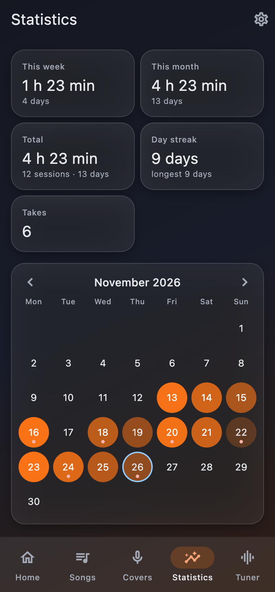
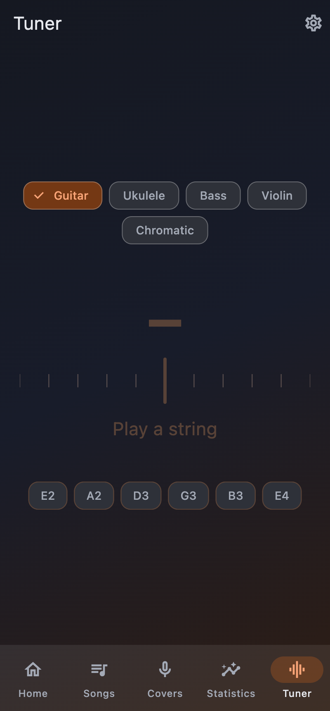
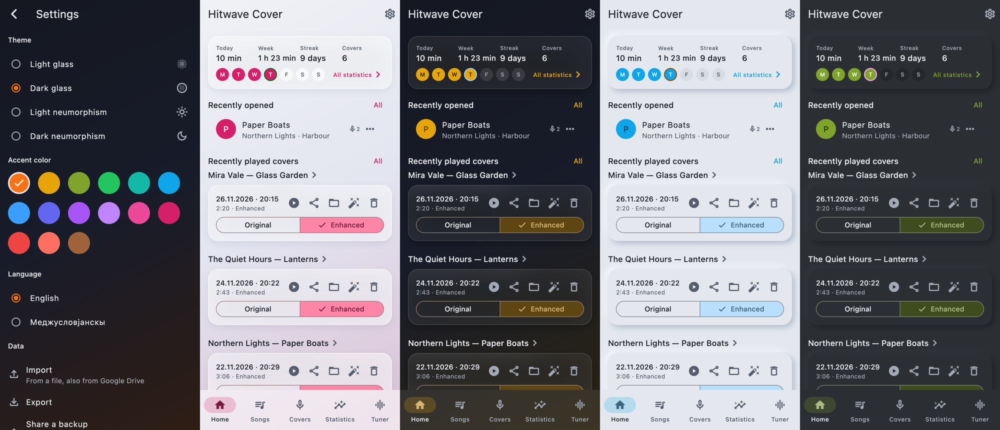

# Hitwave Cover

[English](README.md) · **Меджусловјанскы**

Hitwave Cover држи тексты ваших пєснеј и ваше каверы на једном мєсту. Отворите пєсњу, пустите текст течи в вашем темпу, појте и запишите запис — апликација очисти звук на устројству, држи всакы запис при јего пєсњи и рахује, колико вы тренујете. Тјунер јест внутри.

Написано на Flutter за Android, iOS, macOS, Windows, Linux и веб.

## Снимкы екрана

| Дом | Текст | Моје каверы | Статистика | Тјунер |
|---|---|---|---|---|
|  |  |  |  |  |


### Темы

Четыри стиља — свєтло и темно стекло, свєтлы и темны неуморфизм — и петнадсет барв акцента; избирајут се в Наставјењах, нова тема, барва или језык прєходи гладко:



Снимкы сут зроблене из демо-пєснеј тестом `integration_test/readme_screenshots_test.dart` (глејте Развој).

## Можности

### Пєсње и тексты

- Библиотека пєснеј с артистом, назвоју, албумом и текстом: додавајте, уредите и одстрањајте је.
- Искање по пєсњи или артисту; разврстање по артистах, А–Ж, недавно отвореных или по числу каверов.
- Страница текста сама прокручује текст. Быстрость и вступ прєд првоју линијеју сут запаметане за всаку пєсњу.
- **Акорды** сут обарвене: линије акордов (`Am   F   C`), низы акордов прєд словами (`Intro: Em G`), акорды в заградах — такоже прилєплене к слову, како их пише ChordPro (`[Am]We folded every [F]promise`). Дотык акорда, кторы јест в истинє слово (`A girl to hold`), оставја јего текстом; јешче једен дотык јего чини акордом опет.
- **Табулатуры** држет своје колоны в шрифтє с једнакоју ширином и малєјут, да бы се вмєстили на екран.

### Запис каверов

- Означите **Запис** и притисните **Старт**: запис иде, доколє текст се прокручује.
- Изберите микрофон; апликација упозори на запис без звука.
- **Улєпшење гласа** иде на устројству в чистом Dart ([revoockv_audio_enhance](https://pub.dev/packages/revoockv_audio_enhance)): одстрањаје гул и постојанны шум, выравњаје гласност и, ако хочете, одрєзаје тишину прєд и по пєнју. Оригинал и улєпшены запис оба оставајут.
- Слушајте записы, пошлите запис како MP3 (с готовым описом) или покажите јего в папке.
- **Моје каверы**: все записы всих пєснеј в једном спису, с искањем.

### Тјунер

- Гитара, укулеле, бас и скрипка в обычном строју, или всака нота (хроматичны).
- Игла слєди струну в реалном врємени (около 47 мєрењ в секунду) на скалє ±50 центов, с најближшоју струноју и что дєлати (натегни, опусти, настројено); высота се мєри до части цента.
- Своја картка и кнопка на страници текста; тјунер освобађаје микрофон, когда он или апликација се скрыје.

### Тренинг

- Врєме с каждоју пєсњеју се рахује само; не означите **Тренинг** на страници текста, да бы само прокручивати текст (или само записати запис) без рахуња.
- Статистика: днес, тутој тыдењ и тутој мєсец, серија дњев, число записов, календар мєсеца с дњами тренинга и најчестєје пєсње.
- Домашња картка показује недавно отворене пєсње и недавно слушане каверы.

### Синхронизација и резервне копије

- Все остаје на устројству; конто не јест потрєбно.
- **Синхронизација међу устројствами** в локалној сети Wi‑Fi: једно устројство показује QR-код, друго јего сканује. Пєсње, каверы, тренингы и хисторија се сједињајут; ничто не јест одстрањено без пытања — апликација показује разлики и даје избрати, что дєлати на обох устројствах.
- **Резервна копија**: експортујте пєсње в фајл и импортујте је назад; с записами фајл јест ZIP-архив.
- **Наставјења → Дане** такоже очишчајут пєсње, каверы, статистику тренингов или хисторију.

### Наставјења

- **Језык**: англијскы (по умолчању) или меджусловјанскы (писаны кирилицоју).
- **Тема**: свєтло или темно стекло, свєтлы или темны неуморфизм.
- **Барва акцента**: једна из петнадсет.

## Како почети

Трєбује се: Flutter (Dart `^3.12`); Xcode за iOS и macOS, Android Studio за Android.

```bash
flutter pub get
flutter run
```

Вебова верзија не имаје фајловој системы и синхронизације међу устројствами: там апликација држи пєсње и тексты без записа и улєпшења гласа.

## Развој

- **Архитектура**: чиста архитектура по шаблону `revoockv-original@2.0.0` скила [revoockv-flutter-clean-arch](https://github.com/revoockv/revoockv-flutter-clean-arch) (глејте `.clean_arch.toml`); јего линтер провєрјаје код в CI: всака функција в `lib/features/<feature>/` имаје слоје `data`, `domain` и `presentation`; стан живе в репозиторијах како `ValueNotifier` и доходи до интерфејса чрез use case-ы и `watch_it`; зависности сут регистроване с GetIt.
- **Грєшкы**: операције врачајут `Result<T, F>`, кде `F` јест енум грєшек функције; јего текст се избираје в `presentation/l10n/`.
- **Преводы**: [slang](https://pub.dev/packages/slang). Тексты сут в `lib/core/presentation/l10n/en.i18n.json` и `isv.i18n.json`; по измєнах пустите `dart run slang`. Меджусловјанскы тексты сут провєрене по словнику [interslavic-dictionary.com](https://interslavic-dictionary.com/).
- **Темы**: `lib/core/presentation/theme.dart` гради тему из стиља, јаркости и акцента; `SurfaceWidget` рисује стекљане или неуморфне панели.
- **Храњење**: Hive на устројству.

```bash
tool/check.sh   # analyze, тесты и линтер архитектуры — точно то, что иде в CI
```

**Снимкы екрана**: пустите на macOS (демо-дане живут в своју папку и сут потом одстрањене), потом копирујте PNG из напечатаној папкы в `docs/screenshots/` (`themes.png` јест `phone_settings` и четыри `look_*` једно при другом, в половичној величини):

```bash
flutter test integration_test/readme_screenshots_test.dart -d macos \
  --dart-define=HITWAVE_STORAGE_FOLDER=readme_screenshots
```

Демо-пєсње, тренингы и записы сут измышлене (`integration_test/demo_data.dart`). Те саме дане с долгыми тренингами провєрјајут размєшчење: все екраны на телефону 320 px на обох језыках; тест паде, ако нєкакы текст не вмєсти се:

```bash
flutter test integration_test/narrow_layout_test.dart -d macos \
  --dart-define=HITWAVE_STORAGE_FOLDER=narrow_layout
```

Git: `develop` сбира работу; всака измєна имаје своју вєтву — `feature/NNN-name`, `fix/NNN-name`, `refactor/NNN-name`, `docs/NNN-name` — с комитами `[TYPE-NNN] …`, слита в `develop` с `--no-ff`.
