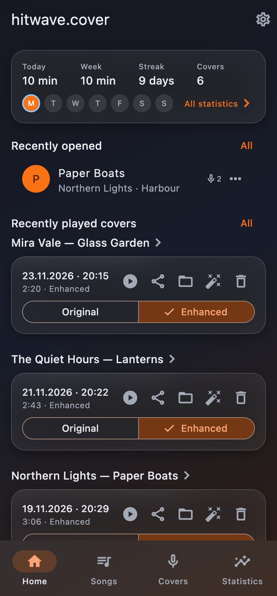
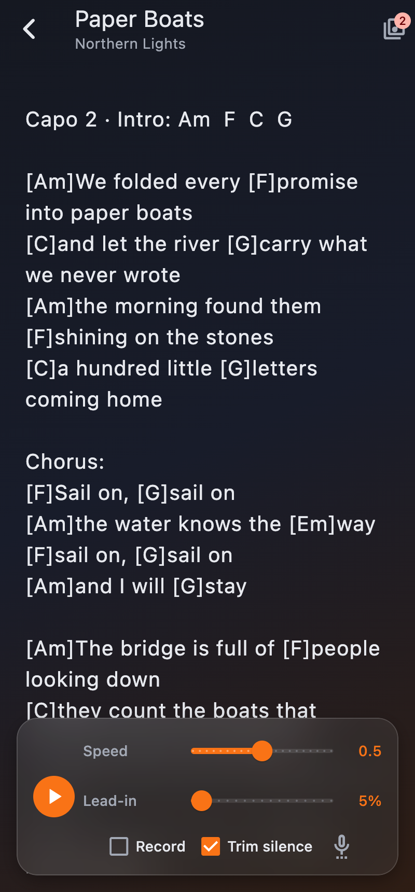
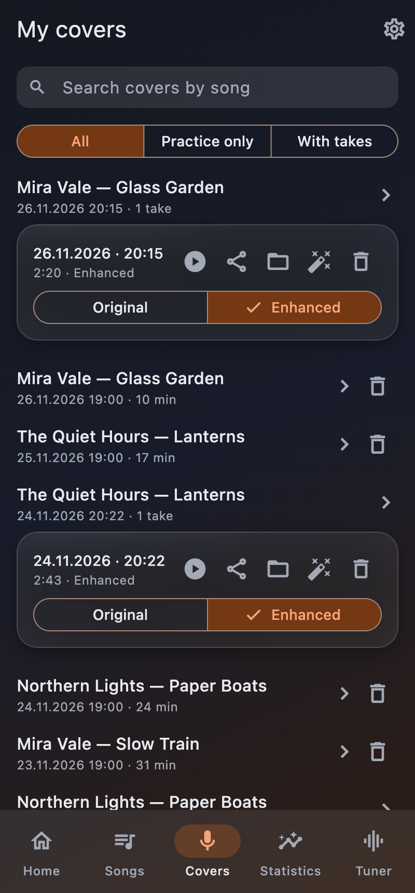
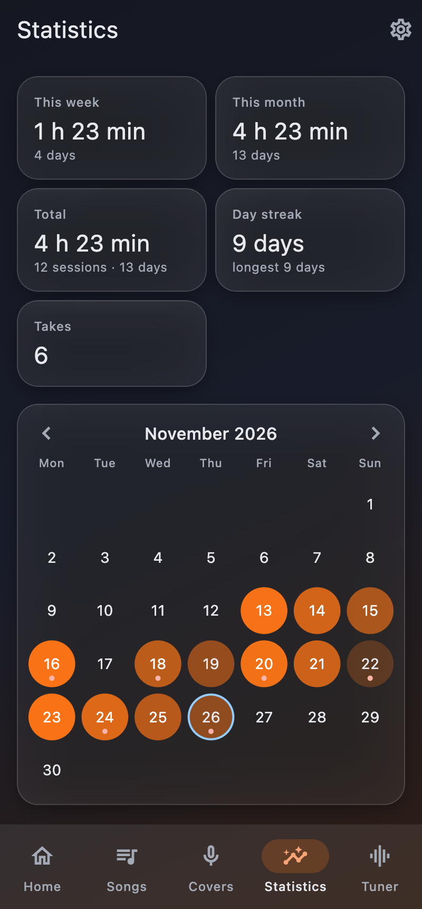
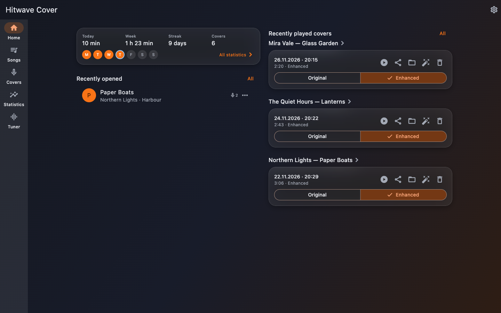
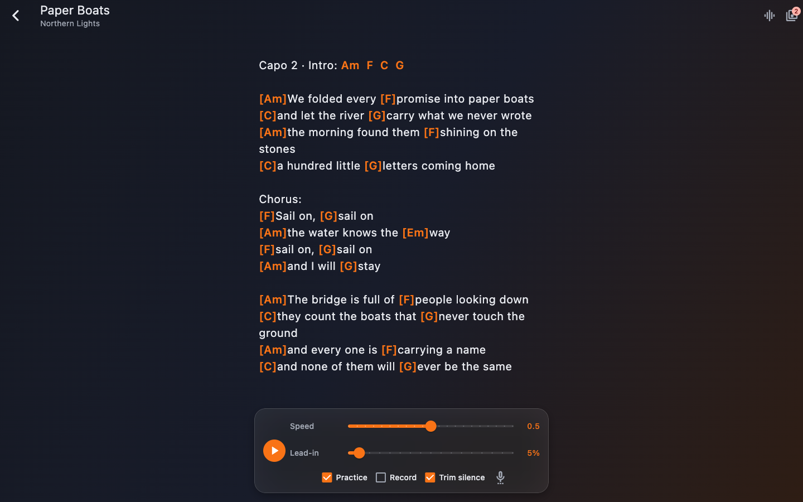
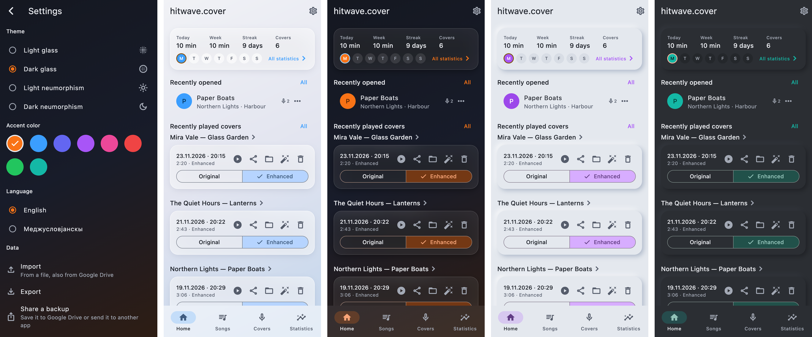

# Hitwave Cover

**English** · [Меджусловјанскы](README.isv.md)

Hitwave Cover keeps your song lyrics and your cover recordings in one place. Open a song, let the
lyrics scroll at your pace, sing along and record a take — the app cleans up the sound on the
device, keeps every take next to its song and counts how much you practice.

Built with Flutter for Android, iOS, macOS, Windows, Linux and the web.

## Screenshots

| Home                                     | Lyrics                                       | My covers                                       | Statistics                                      |
| ---------------------------------------- | -------------------------------------------- | ----------------------------------------------- | ----------------------------------------------- |
|  |  |  |  |





### Themes

Four styles — light and dark glass, light and dark neumorphism — and eight accent colors, chosen in Settings:



The screenshots are made from demo songs by `integration_test/readme_screenshots_test.dart` (see Development).

## Features

### Songs and lyrics

- A library of songs with artist, title, album and lyrics: add, edit and delete them.
- Search by song or artist; sort by artists, A–Z, recently opened or by the number of covers.
- The lyrics page scrolls the text by itself. The speed and the lead-in before the first line are
  remembered for every song.

### Recording covers

- Tick **Record** and press **Start**: the take is recorded while the lyrics scroll.
- Choose the microphone; the app warns about a silent take.
- **Vocal enhancement** runs on the device in pure Dart
  ([revoockv_audio_enhance](https://pub.dev/packages/revoockv_audio_enhance)): it removes rumble and steady noise,
  evens out the loudness and, optionally, trims the silence before and after the singing. The
  original and the enhanced take are both kept.
- Listen to the takes, share one as MP3 (with a ready caption) or show it in its folder.
- **My covers**: every take of every song in one list, with search.

### Practice

- The time spent with each song is counted on its own.
- Statistics: today, this week and this month, the day streak, the number of takes, a month
  calendar of practice days and the most practiced songs.
- The home tab shows the recently opened songs and the recently played covers.

### Sync and backup

- Everything stays on the device; there is no account to create.
- **Sync between devices** over the local Wi‑Fi network: one device shows a QR code, the other
  scans it. Songs, covers, practice and history are merged; nothing is deleted without asking —
  the app shows the differences and lets you choose what to do on both devices.
- **Backup**: export the songs to a file and import them back; with the takes, the file is a
  ZIP archive.
- **Settings → Data** also clears the songs, the covers, the practice statistics or the history.

### Settings

- **Language**: English (default) or Interslavic (Medžuslovjansky, written in Cyrillic).
- **Theme**: light or dark glass, light or dark neumorphism.
- **Accent color**: one of eight.

## Getting started

Requirements: Flutter (Dart `^3.12`); Xcode for iOS and macOS, Android Studio for Android.

```bash
flutter pub get
flutter run
```

The web build has no file system and no sync between devices: there the app keeps the songs and
the lyrics without recording and vocal enhancement.

## Development

- **Architecture**: clean architecture by the `revoockv-original@2.0.0` template of the
  [revoockv-flutter-clean-arch](https://github.com/revoockv/revoockv-flutter-clean-arch) skill (see `.clean_arch.toml`); its linter checks the code in CI: every feature in `lib/features/<feature>/` has `data`, `domain` and
  `presentation` layers; state lives in repositories as `ValueNotifier` and reaches the UI through
  use cases and `watch_it`; dependencies are registered with GetIt.
- **Errors**: operations return `Result<T, F>`, where `F` is the failure enum of the feature; its
  text is chosen in `presentation/l10n/`.
- **Translations**: [slang](https://pub.dev/packages/slang). The texts are in
  `lib/core/presentation/l10n/en.i18n.json` and `isv.i18n.json`; after changing them run
  `dart run slang`.
- **Themes**: `lib/core/presentation/theme.dart` builds the theme of a style, a brightness and an
  accent; `SurfaceWidget` draws glass or neumorphic panels.
- **Storage**: Hive on the device.

```bash
tool/check.sh   # analyze, tests and the architecture linter — exactly what CI runs
```

**The skill's version** is pinned: `tool/clean_arch_skill_version` holds a release tag of the skill, and
`tool/check.sh` (locally and in CI) lints with the linter of that tag, so a change in the skill never changes the
result of an old commit. To move the project to a newer skill, change the tag (and `.clean_arch.toml` when a new
template version is wanted) in one commit. To try an unreleased skill once:
`CLEAN_ARCH_DIR=~/.agents/skills/revoockv-flutter-clean-arch tool/check.sh`.

**Release**: `tool/release.sh X.Y.Z` on `develop`, after the CI of `develop` passed. It refuses to run on a
dirty or unpushed `develop`, on a version that is not higher or a tag that exists, and when the checks fail; then
it merges into `main`, tags `vX.Y.Z` and pushes everything at once. A tag is never moved: a failed release is
fixed on `develop` and released as the next patch version.

**CI** (`.github/workflows/ci.yml`): every push to `develop` and every pull request runs
`flutter analyze`, the tests and the architecture linter. A pushed tag `vX.Y.Z` also builds the app
for Android (APK), Windows, Linux and the web and attaches the builds to the GitHub release of that tag;
**Run workflow** in the Actions tab makes the same builds as workflow artifacts. The macOS build is off for now
(GitHub's macOS runners are often unavailable): build it on a Mac with `flutter build macos --release` and add
it to the release by hand. The Windows build is not signed, so Windows asks to confirm the first start.

**Screenshots**: run on macOS (the demo data lives in its own storage folder and is deleted afterwards),
then copy the PNGs from the printed folder to `docs/screenshots/` (`themes.png` is `phone_settings` and the four
`look_*` shots side by side, at half size):

```bash
flutter test integration_test/readme_screenshots_test.dart -d macos \
  --dart-define=HITWAVE_STORAGE_FOLDER=readme_screenshots
```

Git: `develop` collects the work; every change has its own branch — `feature/NNN-name`,
`fix/NNN-name`, `refactor/NNN-name`, `docs/NNN-name` — with commits `[TYPE-NNN] …`, merged into
`develop` with `--no-ff`.
